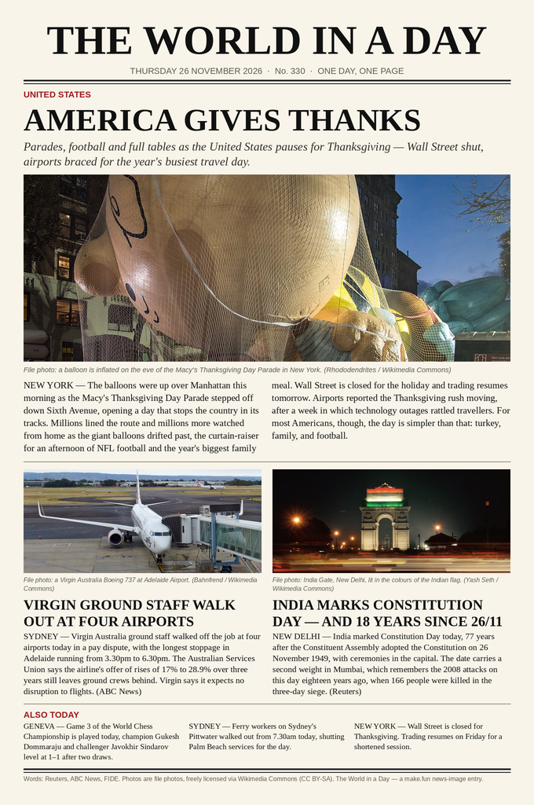

# news-image-20261126

[](https://make.fun/competitions/news-image-20261126)
[](https://make.fun/competitions/news-image-20261126)
[](https://make.fun/competitions/news-image-20261126)

A broadsheet summing up the world's news of **Thursday 26 November 2026**
in one image — an entry for make.fun's
[Sum up 26 November's world news in one image](https://make.fun/competitions/news-image-20261126)
bounty ($100, top 50 share). This edition keeps the winning broadsheet
structure of the series (seven straight placements) with a new nameplate,
a portrait lead photo and a two-story second row.



## The day, in brief

- **New York** — America gives thanks: the Macy's Thanksgiving Day
  Parade stepped off down Sixth Avenue, the curtain-raiser for an
  afternoon of NFL football and the year's biggest family meal. Wall
  Street is closed for the holiday; airports reported the Thanksgiving
  rush moving after a week of technology outages rattled travellers.
- **Sydney** — Virgin Australia ground staff walked off the job at four
  airports today in a pay dispute, with the longest stoppage in Adelaide
  running from 3.30pm to 6.30pm. The union says the airline's offer of
  rises of 17% to 28.9% over three years still leaves ground crews
  behind; Virgin says it expects no disruption to flights. (ABC News)
- **New Delhi** — India marked Constitution Day today, 77 years after the
  Constituent Assembly adopted the Constitution on 26 November 1949. The
  date carries a second weight in Mumbai, which remembers the 2008 attacks
  on this day eighteen years ago, when 166 people were killed in the
  three-day siege. (Reuters)
- **Also today** — Game 3 of the World Chess Championship is played in
  Geneva, Gukesh Dommaraju and Javokhir Sindarov level at 1–1 after two
  draws; ferry workers on Sydney's Pittwater walked out from 7.30am,
  shutting Palm Beach services; Wall Street is closed for Thanksgiving.

Every story's event was date-checked against primary sources: the event
itself happened on 26 November 2026 — not merely reported then. Stories
whose events fell on 25 November (the Sudan strikes, the Gaza strike, the
Ramaphosa ruling, the Bangladesh wage decision, the North Korea–Swiss
expulsion, the Lebanon airport plan, the Canary Islands arrivals) were
all checked and dropped.

## Photos

Real freely licensed file photos via Wikimedia Commons (CC BY-SA), none
taken today, captioned as file photos on the page:

- Parade balloon inflation, New York — Rhododendrites (CC BY-SA 4.0)
- Virgin Australia Boeing 737, Adelaide — Bahnfrend (CC BY-SA 4.0)
- India Gate, New Delhi — Yash Seth (CC BY-SA 4.0)

## How it works

`tools/render.py` draws the 680×1024 front page with Pillow (build time
only) and writes `entry.png`. `main.py` (standard library only, no
network) verifies that PNG chunk by chunk and copies those exact bytes to
the grader's output directory. Two runs write identical bytes.

```
python3 tools/render.py
MAKEFUN_OUTPUT_DIR=/tmp/out python3 main.py
```
